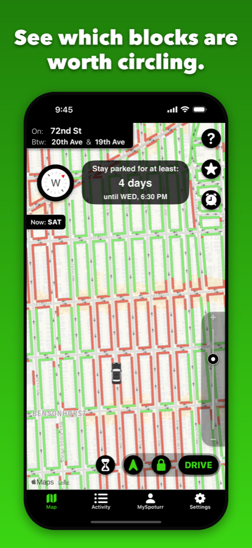
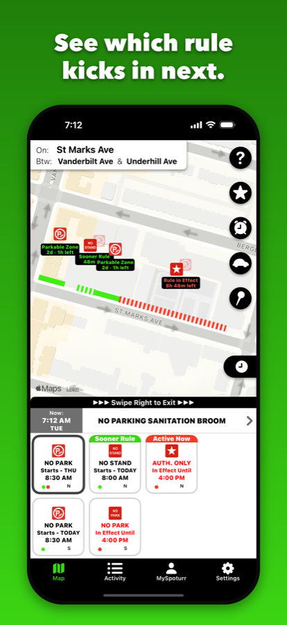
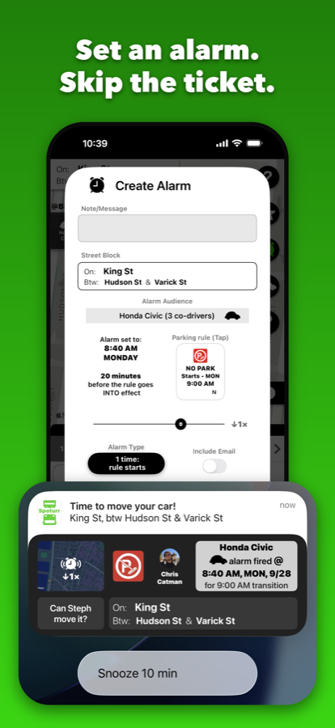
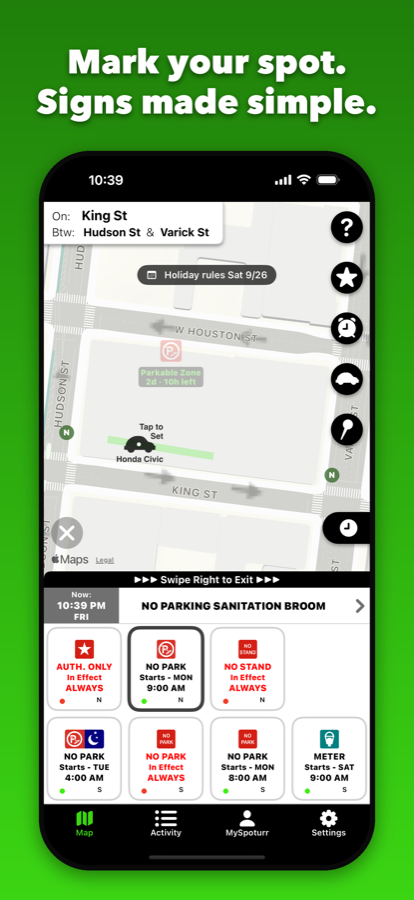
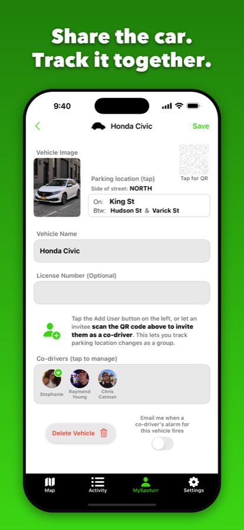
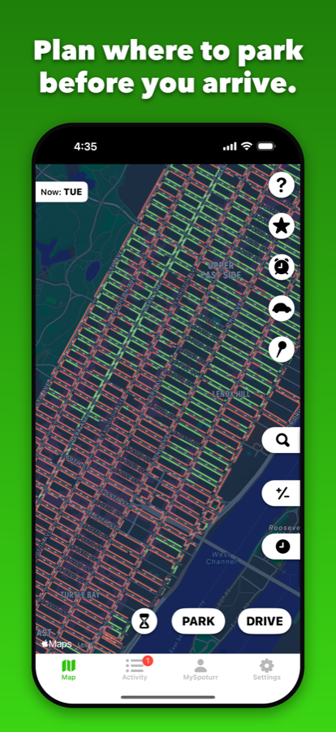
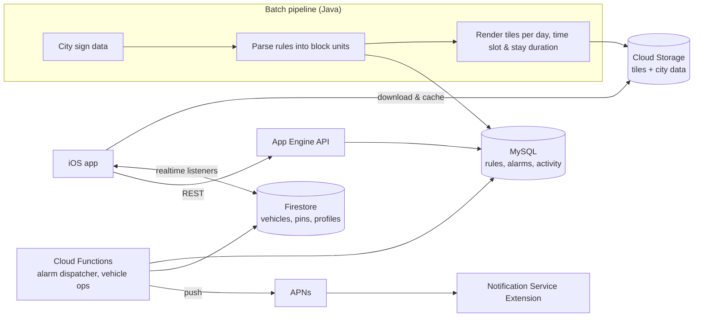

# Spoturr

**Spoturr tells you which blocks are a waste of time when you're hunting for a free spot, based on how long you need to stay parked.**

Want to leave the car through the weekend? Set the duration, skip the red, and head for the green.

[**Download on the App Store**](https://apps.apple.com/app/id6450056814) · iPhone & iPad · Built and shipped solo

  
  
  

  
  
  

> The source code is private (it's a live product with a live backend). This repo describes how it's built. I'm happy to walk through the codebase on a call.

---

## What it does

- **Green/red curb grid.** Every block face in the city, colored by whether you can park there for free right now.

- **"Stay parked for at least…" dial.** Recolors the grid for a chosen minimum stay, from 6 hours up to 7 days. The ceiling follows the city's rule cycle (NYC's schedules repeat weekly), and holiday rule suspensions are factored in, so an upcoming holiday can surface blocks where a stay stretches past a week.

- **Block View.** Tap a block to inspect its parking rules one at a time, with each rule's schedule and the exact curb zones it covers. Each zone shows whether you can park there right now, whether another rule affects it, and how long until its next rule transition.

- **Alarms.** Get notified up to an hour before a rule kicks in or ends, as a rich notification with a map of the block, plus an optional email. Alarms can be one-off or repeating, can be snoozed right from the notification, and vehicle alarms reach every co-driver.

- **Shared vehicles.** A vehicle has one admin and up to 10 drivers, and any member can invite others by link or QR code. Members see where the car is parked, get a push notification when it moves, and have an activity feed of who moved it. Alarms can be targeted at a vehicle, in which case every co-driver gets the push notification, and each co-driver can opt in to email per vehicle.

---

## Tech stack

| | |
|---|---|
| **iOS** | Swift, UIKit, MapKit, RxSwift, Swift Concurrency, SQLite, Notification Service Extension, App Groups |
| **Backend** | Firebase (Auth, Firestore, Cloud Functions, Storage, Cloud Messaging), Google App Engine (Node.js REST API), Cloud SQL (MySQL) |
| **Data pipeline** | Java batch jobs on Compute Engine that ingest city sign data and pre-render map tiles |

---

## Architecture

Spoturr has two very different kinds of data, so they live in different systems:

- **Parking rules** change rarely, are large, and must work offline. They're processed in a batch pipeline, stored in MySQL, and shipped to the phone as a local database plus pre-rendered map tiles. City data arrives in different shapes (NYC publishes individual signposts with arrows; San Francisco publishes some rules as curb segments), and the pipeline normalizes them into one city-agnostic model of blocks, curb zones and schedules, so the app never knows which city a rule came from.

- **User data** (vehicles, pins, alarms, activity) changes constantly. Live shared state sits in Firestore with realtime listeners. Queryable records (alarms, activity feed) sit in MySQL behind a REST API.

---

## Engineering decisions

### 1. Pre-rendered map tiles instead of live geometry

**Problem.** The answer for each block depends on the day, the half-hour time slot and how long you want to stay. Drawing tens of thousands of block polylines live in MapKit, and recoloring them every time the dial moves, is too heavy at city zoom levels.

**Decision.** The batch pipeline computes the answer ahead of time for every map tile × day × time slot × stay duration and renders each combination as an image. At city zoom, the app composites image tiles instead of computing geometry. Live polylines are used only when you zoom into a single block, where the count is small and detail matters.

**Making it affordable:**
- **Content-addressed dedup.** Many combinations produce identical pixels, so each image is named by a hash of its content. About **500k tile signatures collapse to ~36k unique images (~13.6:1)**. The app resolves *signature → content hash* before every disk or network access.

- **Batch performance.** Profiling showed ~80% of batch time in rule arbitration, not I/O. Parallelizing that work within each time slot made the batch **~3.4× faster** with byte-identical output.

**Trade-off.** Rules refresh on the batch cadence rather than instantly, and the pipeline is more complex. For parking rules, which change rarely, that's the right trade.

### 2. Memory-aware tile caching on the device

A decoded map tile is a large bitmap, and a phone can't hold many. The cache is built around that:

- **Three tiers, three budgets.** Compressed PNGs on disk (~160 KB each, capped around 400 MB); decoded bitmaps in a cache sized to **7.5% of device RAM**; and a small set of pinned renderers whose count is derived from RAM (**3 on a 3 GB device, 12 on 12 GB**).

- **One ranking, three cut points.** A single priority list (your parked car, your upcoming alarms, your pins, where you usually browse, then downtown) decides what each tier keeps. Each tier takes as much of that list as its own budget allows.

- **Cheaper bitmaps.** Traffic-direction arrows are stored as 8-bit alpha masks and tinted at draw time instead of full color, which halved per-tile memory (**~41 MB → ~20 MB**).

- **Memory pressure.** On system memory warnings the app sheds renderers (bitmaps stay reclaimable), and it rebuilds them when pressure returns to normal.

- **Concurrency.** Downloads run in a bounded pool (6 at a time), de-duplicated by content hash, and prioritized by distance from the map center. Every download attempt carries an identity token, so a cancelled request's late callback can't corrupt a newer request for the same image. Shared state is guarded so that every check-then-act happens inside a single critical section.

### 3. Alarm delivery you can rely on

A parking alarm that arrives late, or not at all, means a ticket. Delivery has several layers:

- **Server dispatch.** A dispatcher runs every minute and looks back over a short catch-up window, so a missed tick delays an alarm instead of losing it. The scheduler delivers *at least once*, so each alarm is claimed with a conditional database update before sending, and only the winner sends.

- **On the dot.** The push is sent ~20 seconds early. A Notification Service Extension renders a rich badge (map snapshot plus rule glyph) and holds delivery until the exact fire time.

- **On-device backstop.** The app mirrors every upcoming alarm as a local notification set to fire 30 seconds after the push is due. When the push arrives, the extension cancels the local one; if the phone was offline, the local one fires instead. App and extension agree on notification IDs derived from *(alarm, fire time)*, so neither can cancel the other's wrong occurrence.

- **Time correctness.** Signs are local wall-clock rules, so all scheduling is timezone- and DST-aware. The same DST rules are implemented in Java, Swift and JavaScript, with parity pinned by identical test vectors.

**A bug worth telling:** rich notifications silently fell back to plain ones, only on real devices and only in release builds. The cause was a co-driver's profile photo in Display-P3 (any iPhone camera shot). It promoted the drawing canvas to 16-bit extended range, the JPEG encoder failed on it, and iOS killed the extension with no crash log. The fix normalizes every image to sRGB at the input.

### 4. Cost-aware realtime sync between co-drivers

Co-drivers share a vehicle document in Firestore, while the activity feed lives in MySQL. Other members' devices need to know when to refetch, without polling and without a second realtime system.

- **Piggybacking.** A small `{at, type}` signal field rides along inside writes that already update the vehicle document (parking, joining, leaving). That costs **zero extra writes**. Devices already listening to the document see the timestamp advance and do a debounced refetch.

- **Only one event needs its own write.** An alarm firing changes nothing else on the vehicle, so it's the single case that writes the signal on its own. Deleting a vehicle needs no signal: the removal itself is one.

- **Server-owned.** Only the backend can write the signal, so clients can't forge activity for others.

- **Suspended apps.** A listener only works while the app is running, so a silent push wakes members' devices when a shared alarm changes, letting their on-device backstops stay correct.

---

## Testing

- **300+ backend tests**: Jest with the Firebase emulator (vehicle sharing, invitations, alarm dispatch, scheduling, DST)
- **270+ JUnit tests** for the city sign-parsing pipeline, including DST transition vectors
- Release-build verification on physical devices for push and extension behavior, which the simulator can't reproduce
